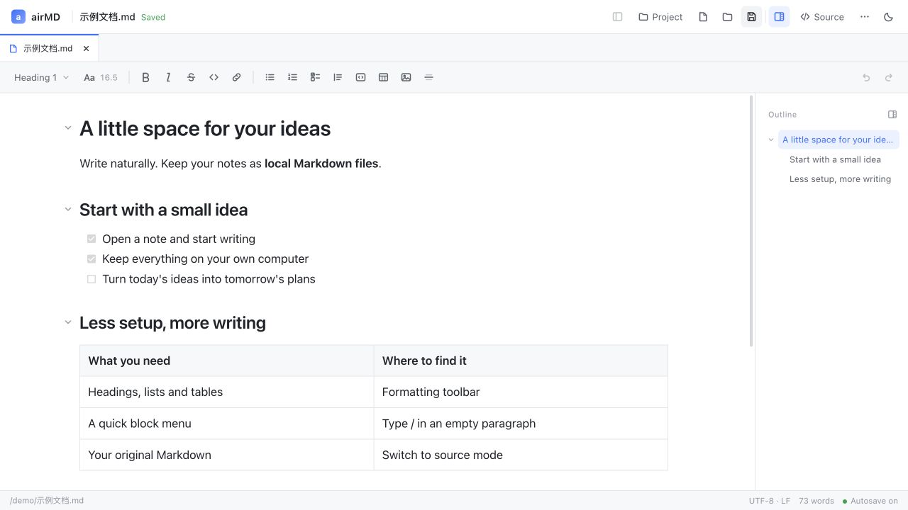

# airMD

**Double-click a note. Open a whole project. Keep writing.**

A local Markdown editor with a document-style editing experience, made for the growing pile of files that comes with Vibe Coding.

[简体中文](README.md) · English

[](package.json)
[](LICENSE)


[](https://github.com/Barryhzy/airMD-release)


[Download](https://github.com/Barryhzy/airMD-release/releases) · [Get started](#get-started) · [Why airMD](#why-i-built-airmd) · [Share feedback](https://github.com/Barryhzy/airMD-release/issues)

airMD is a **free, open-source Markdown desktop editor**. Double-click a file for a quick edit, or open a project folder and work across multiple tabs. Your changes save directly to local `.md` files. Everyday editing works entirely offline.



*Browser demo. The desktop app reads and writes local files directly.*

## Why I built airMD

Vibe Coding leaves my projects with a growing collection of Markdown files: READMEs, requirements, implementation plans, task lists, and Agent handoff notes. After reading them, I still need to add details, make corrections, and keep them useful.

Markdown is simple, but editing raw syntax every time is not how I prefer to write. I like Yuque's document-style editing: see the content and change it directly. Moving local project files into Yuque and exporting them again adds steps to a small edit.

I also tried Obsidian, Typora, and VS Code. Each has its strengths, but none quite matched the workflow I wanted: **double-click a local file, edit it, and keep it where it belongs; when the files pile up, open the project and keep going.**

That's why I built airMD: to bring the document editing experience I enjoy to local Markdown files.

## One document, or a whole project

| How you work | How airMD helps |
| --- | --- |
| **An occasional edit** | Set airMD as your default Markdown app, then double-click a `.md` file to read, edit, and autosave. |
| **Daily work across documents** | Open a project folder, filter files in the sidebar, and keep requirements, plans, and notes open in separate tabs. |
| **Writing alongside AI** | Open Markdown generated by an Agent, add context, update tasks, and keep the files in their original project folder. |

Use it for a quick change to one file or a longer writing session across many documents.

## Details that make editing easier

- **Edit what you see**: headings, bold, lists, tasks, quotes, code blocks, tables, images, and links. Type `/` in an empty paragraph to insert a block.
- **Open in place, save in place**: no import/export cycle. Existing files autosave about one second after you stop typing, with a visible save status.
- **Projects and tabs**: find documents with a file tree and path filtering. Switching tabs keeps your edits, scroll position, and undo history.
- **Comfortable long-form writing**: an outline, collapsible headings, adjustable font size, and light and dark themes.
- **Source when you need it**: switch between visual and source modes. Content the editor cannot fully preserve opens in source mode with a warning by default.
- **Your files, your workflow**: Windows and macOS, Simplified Chinese and English. No account required; your documents stay under your control.

## Install

Download the Windows or macOS installer from [Releases](https://github.com/Barryhzy/airMD-release/releases). This release provides Windows x64 and Apple Silicon (arm64) installers. Node.js and Rust are not required to use a packaged desktop app.

| System | Installation |
| --- | --- |
| Windows 10 / 11 | Download `airMD_0.4.3_x64-setup.exe` and follow the installer prompts. |
| macOS 11 or later | On Apple Silicon, download `airMD_0.4.3_aarch64.dmg` and drag airMD into Applications. Intel Macs need a source build. |

If a package for your platform is not available yet, follow the source instructions below. Current macOS builds use ad-hoc signing and are not signed with an Apple Developer identity or notarized.

## Get started

**Editing one file?** After installation, set airMD as the default app for `.md` files and double-click to open them. You can also choose airMD from your system's Open With menu.

**Working on a project?** Click Project, choose a folder, and open documents from the file tree. Each document gets its own tab.

1. **Open a file**: click Open to select a `.md` file, or click Project to open a notes folder.
2. **Start writing**: type as you would in a document. Use the toolbar to format text, or type `/` in an empty paragraph to insert a block.
3. **Let it save**: existing files save automatically about one second after you stop typing. Check the status bar for confirmation. For a new document, press `Ctrl/⌘ + S` to choose where to save it first.

Opening the same file again selects its existing tab. Switching tabs keeps your edits and undo history. When closing a tab with unsaved changes, you can save, discard, or cancel.

To change the interface language, choose **… → 界面语言 / Language**, save the setting, and restart the app.

### Keyboard shortcuts

Use `Ctrl` on Windows and `⌘` on macOS, except when switching tabs.

| Action | Shortcut |
| --- | --- |
| New / Open file | `Ctrl/⌘ + N` / `Ctrl/⌘ + O` |
| Open folder | `Ctrl/⌘ + Shift + O` |
| Save / Save as | `Ctrl/⌘ + S` / `Ctrl/⌘ + Shift + S` |
| Bold / Italic | `Ctrl/⌘ + B` / `Ctrl/⌘ + I` |
| Undo / Redo | `Ctrl/⌘ + Z` / `Ctrl/⌘ + Shift + Z` |
| Toggle source mode | `Ctrl/⌘ + E` |
| Next / Previous tab | `Ctrl + Tab` / `Ctrl + Shift + Tab` (Control on both platforms) |

## File compatibility

airMD primarily supports CommonMark and GitHub Flavored Markdown. Saving in visual mode may normalize formatting such as list markers and table spacing.

**Documents containing HTML or YAML frontmatter open in source mode by default to preserve the original content.** Choosing “Edit visually anyway” or “Don't warn again (all Markdown files)” lets you continue, but does not add support for those formats. Saving may still change or lose that content. Use source mode when it needs to stay intact.

The app prompts you to resolve external file conflicts, read-only files, or encodings it cannot safely write back. PDF/HTML export, in-document find and replace, and restoring tabs or unsaved drafts after a restart are not yet supported.

Desktop link navigation is not yet complete. Use the file tree to open documents and the outline to navigate headings. See [known limitations](docs/KNOWN_LIMITATIONS.md).

## Run from source

The frontend requires **Node.js 22.12+** and npm. The desktop app also requires stable Rust and your platform's build tools.

```bash
git clone https://github.com/Barryhzy/airMD-release.git
cd airMD-release
npm ci
npm run dev
```

Open `http://localhost:1420` in your browser and select a sample document. **The browser demo stores data in browser local storage and does not write directly to the original files on your computer.** Clearing browser data removes demo content.

### Desktop development and packaging

- **macOS**: install Xcode Command Line Tools.
- **Windows**: install Visual Studio Build Tools with the “Desktop development with C++” workload, use the Rust MSVC toolchain, and ensure WebView2 is installed. If you already use MinGW, see the script below.

After installing the dependencies above, run:

```bash
npm run dev:tauri      # Start the desktop development app
npm run build:mac      # macOS: build .app and .dmg bundles
npm run build:tauri    # Windows: build the NSIS installer
```

The macOS `.dmg` is copied to `release/`. Windows installers are generated in `src-tauri/target/release/bundle/nsis/`.

For a Windows GNU build, run this in Git Bash, using the actual path to your complete MinGW installation:

```bash
MINGW_BIN="C:/msys64/mingw64/bin" bash scripts/build-windows.sh
```

Use an ASCII-only project path for MinGW builds and run only one Cargo build at a time.

### Checks and tests

```bash
npm run build                # Type checking and frontend build
npm test                     # Unit tests
npx playwright install chromium
npm run test:e2e             # Browser end-to-end tests
```

Built with Tauri 2, React, TypeScript, and Milkdown. See the [architecture notes](docs/ARCHITECTURE.md) (in Chinese) for implementation details.

## Feedback and contributions

[Issues](https://github.com/Barryhzy/airMD-release/issues) and pull requests are welcome. When reporting a bug, include the app version, operating system, steps to reproduce, and a minimal example you can share publicly.

If Vibe Coding has left you with a pile of Markdown files, or you simply want an easier way to edit local notes, consider giving airMD a [Star](https://github.com/Barryhzy/airMD-release). I'd also love to hear which small editing frustrations you want it to solve.

## License

[MIT](LICENSE). You are welcome to use, modify, and redistribute airMD.
